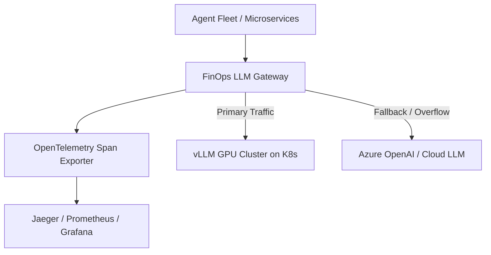

# Agentic FinOps & OpenTelemetry LLM Gateway

[](https://github.com/defrox/agentic-finops-otel-gateway/actions/workflows/ci.yml)
[](https://kubernetes.io/)
[](https://opentelemetry.io/)

An enterprise **LLM Inference & FinOps Gateway** combining **LiteLLM**, self-hosted **vLLM** routing on Kubernetes, and **OpenTelemetry** distributed tracing. Designed to give platform teams real-time token attribution, per-tenant cost tracking, and automatic fallback across private and public models.

## Architecture



## Key Features
* **Real-Time FinOps Attribution:** Injects `finops.tenant_id`, `llm.tokens.total`, and `finops.cost_usd` directly into OpenTelemetry trace spans.
* **Hybrid GPU Routing:** Prioritizes internal vLLM clusters to reduce inference spend while maintaining cloud fallback SLAs.
* **Kubernetes Native:** Includes deployment manifests ready for Horizontal Pod Autoscaling (HPA) and KServe integration.

## Quickstart

```bash
# 1. Start local observability stack (Jaeger + Gateway)
docker compose up -d

# 2. Run telemetry cost attribution demo
python telemetry/otel_middleware.py
```

## Author
**Christian Axel Schmidt** — Principal AI & Systems Architect
